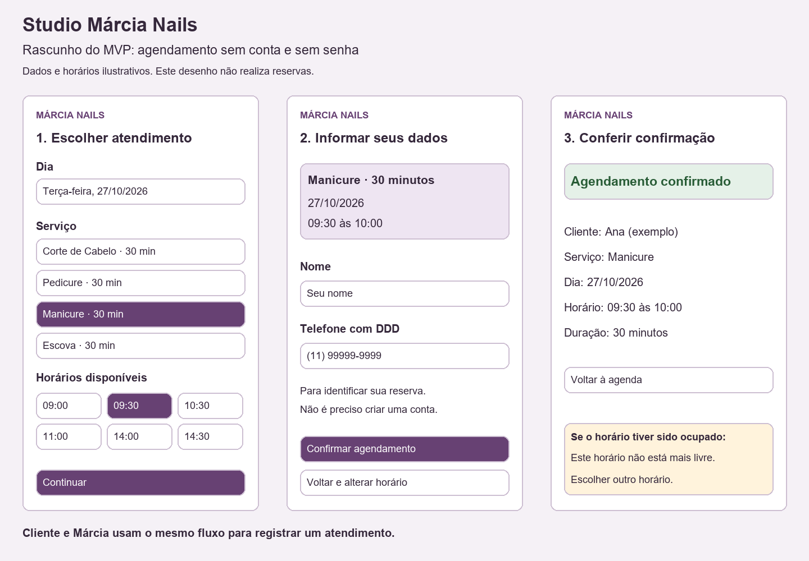

# MVP — Agendamento simplificado

Permitir que a cliente escolha um dia, consulte horários livres e agende sem criar conta ou senha. Márcia pode registrar um atendimento pelo mesmo fluxo, informando os dados da cliente.

## Serviços fixos do MVP

| Serviço | Duração |
|---|---|
| Corte de Cabelo | 30 minutos |
| Pedicure | 30 minutos |
| Manicure | 30 minutos |
| Escova | 30 minutos |

A personalização de serviços e durações por Márcia ficará para depois da conclusão das atividades acadêmicas.

## Dias e horários de atendimento

Márcia atende de segunda-feira a sábado. Todos os serviços do MVP têm duração de 30 minutos.

- Manhã: das 08:00 às 12:00, com último agendamento às 11:30;
- Almoço: das 12:00 às 13:00, sem agendamentos;
- Tarde: das 13:00 às 18:00, com último agendamento às 17:30;
- Domingo: sem atendimento.

A agenda oferece até 18 horários por dia. Apenas os horários livres devem aparecer para seleção.

## Fluxo

1. Escolher dia e serviço;
2. Consultar e selecionar um horário livre;
3. Informar nome e telefone com DDD;
4. Conferir o resumo e confirmar;
5. Visualizar serviço, data, início e término da reserva.

O registro da cliente acontece durante o agendamento, sem cadastro separado.

## Regras previstas

- Cada atendimento ocupa 30 minutos da agenda de Márcia;
- Horários ocupados não aparecem como disponíveis;
- Ao confirmar, conferir novamente a disponibilidade para impedir sobreposição;
- Se o horário tiver sido ocupado, mostrar um aviso e permitir escolher outro;
- Nome, telefone, serviço, dia e horário são obrigatórios;
- Dados de contato não aparecem na consulta pública de horários;
- A confirmação será na tela. Lembretes automáticos não fazem parte deste rascunho.

## Critérios de aceite da consulta de horários

- De segunda-feira a sábado, um dia sem reservas apresenta 18 horários disponíveis;
- Aos domingos, a agenda não oferece horários;
- Os horários são apresentados em ordem, com intervalos de 30 minutos;
- O último atendimento da manhã começa às 11:30 e termina às 12:00;
- O primeiro atendimento da tarde começa às 13:00;
- O último atendimento do dia começa às 17:30 e termina às 18:00;
- Horários reservados deixam de aparecer como disponíveis;
- Se não houver horários livres no dia escolhido, a página informa isso e permite selecionar outro dia.

## Ainda a definir antes de implementar

- Regras para bloquear horários, cancelar e remarcar.
- Proteção das operações e dos dados exclusivos de Márcia.

Os horários e a cliente do desenho são exemplos. O desenho não executa reservas nem comprova acessibilidade; esses critérios serão verificados na interface funcional.

## Rascunho

## Seleção acessível de datas e encaixes

- A data é exibida por extenso em um botão grande, com o mesmo estilo dos horários.
- A lista abre na própria página, sem calendário mensal nem rolagem interna.
- Primeiro aparecem os dias restantes da semana atual. O botão Mostrar mais dias acrescenta uma semana de segunda a sábado por vez, até cinco semanas completas seguintes.
- Aos domingos, a primeira semana exibida já é a próxima semana de atendimento.
- Ao abrir, o sistema prioriza hoje se existir um horário livre que ainda não começou. Caso contrário, seleciona o próximo dia disponível dentro do período.
- Às 17h29, o horário das 17h30 ainda pode ser oferecido. Às 17h30, já não pode ser oferecido.
- O relógio usa America/Sao_Paulo. Nenhuma antecedência mínima adicional é exigida nesta consulta.
- Datas sem horários livres são identificadas por texto. Se todo o período estiver ocupado, uma mensagem informa a ausência de disponibilidade.
- A regra é aplicada na API; o botão não depende do fuso do celular.
- Ao confirmar a reserva, a disponibilidade e o horário deverão ser conferidos novamente. A confirmação agora revalida o horário e grava a reserva no SQLite.

## Salvamento e confirmação

Ao escolher um horário, a cliente preenche nome e telefone. A confirmação é mostrada somente após a gravação no SQLite. O horário reservado deixa de aparecer como disponível.

O servidor valida os campos, os serviços permitidos, o período de datas e o expediente. O telefone é normalizado para reaproveitar o cadastro existente; o envio público não altera nem revela o nome anterior da cliente. A confirmação utiliza uma transação SQLite com BEGIN IMMEDIATE, conferindo novamente a disponibilidade depois de adquirir o bloqueio de escrita. Se houver falha, a transação é desfeita. Nenhuma alteração de tabelas é necessária.

O formulário usa JSON, verificação de origem quando presente, um cabeçalho da aplicação e campo de verificação anti-spam. Há limite de tamanho de requisição e de dez tentativas por minuto por IP no processo atual. Esse limite deverá ser compartilhado na camada de hospedagem se a aplicação passar a usar vários processos. Os logs de falha na reserva não incluem os parâmetros enviados pela cliente.

Uma falha de rede após o envio pode impedir a confirmação na tela mesmo após salvar; por isso a aplicação não repete automaticamente o pedido. A cliente é orientada a conferir com o salão. Não há envio automático de WhatsApp nesta etapa.

O alto contraste fica na barra superior, ao lado de PWA, e continua disponível nas três telas.
